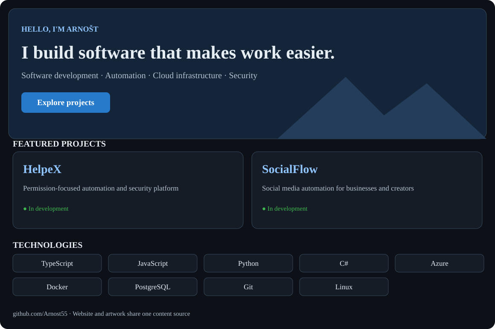
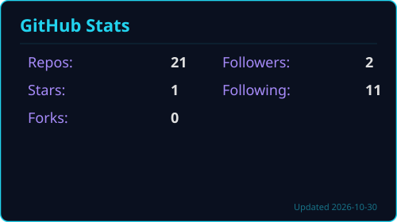
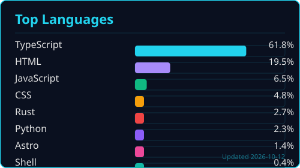
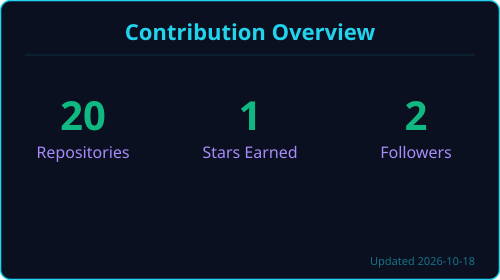

<a href="https://arnost55.github.io/Arnost55/" title="Open interactive React portfolio">
<picture>
  <source media="(prefers-color-scheme: dark)" srcset="profile-dark.svg">
  <source media="(prefers-color-scheme: light)" srcset="profile-light.svg">
  
</picture>
</a>

<a href="https://arnost55.github.io/Arnost55/"><strong>🌐 Open interactive portfolio ↗</strong></a>

<h1 align="center">Hi, I'm Arnošt 👋</h1>

<strong>I build software that makes work easier.</strong>

Software development · Automation · Cloud infrastructure · Security

Based in Slovakia 🇸🇰

  <a href="https://arnost55.dev">Portfolio</a> ·
  <a href="https://linkedin.com/in/arnost-dobrucky">LinkedIn</a> ·
  <a href="mailto:arnika55@kernelkicks.dev">Email</a>

---

### About me

I enjoy building practical software, connecting systems through APIs, and working on reliable infrastructure. My interests span full-stack development, automation, security, and self-hosted systems.

Currently working on **HelpeX** and **SocialFlow**.

### Featured projects

<table>
<tr>
<td width="50%" valign="top">

#### 🛡️ HelpeX
A permission-focused personal assistant and security platform.

- Tool permissions and approval workflows
- Integrations and automation
- Local-first security and infrastructure

**Status:** In development

</td>
<td width="50%" valign="top">

#### 📈 SocialFlow
A social media automation SaaS for businesses and creators.

- Social platform integrations and webhooks
- Automated workflows and lead management
- Cloud deployment and multi-tenant architecture

**Status:** In development

</td>
</tr>
</table>

### Technologies & tools

**Languages**

**Infrastructure & development**

### GitHub activity

<table>
<tr>
<td width="50%">
<picture>
  <source media="(prefers-color-scheme: dark)" srcset="stats/stats-dark.svg">
  <source media="(prefers-color-scheme: light)" srcset="stats/stats-light.svg">
  
</picture>
</td>
<td width="50%">
<picture>
  <source media="(prefers-color-scheme: dark)" srcset="stats/top-langs-dark.svg">
  <source media="(prefers-color-scheme: light)" srcset="stats/top-langs-light.svg">
  
</picture>
</td>
</tr>
</table>

<picture>
  <source media="(prefers-color-scheme: dark)" srcset="stats/streak-dark.svg">
  <source media="(prefers-color-scheme: light)" srcset="stats/streak-light.svg">
  
</picture>

Contribution animation

<picture>
  <source media="(prefers-color-scheme: dark)" srcset="https://raw.githubusercontent.com/Arnost55/Arnost55/output/snake-dark.svg">
  <source media="(prefers-color-scheme: light)" srcset="https://raw.githubusercontent.com/Arnost55/Arnost55/output/snake-light.svg">
  
</picture>

---

  <a href="https://github.com/Arnost55?tab=repositories">Repositories</a> ·
  <a href="https://instagram.com/adobrucky">Instagram</a> ·
  <a href="https://bsky.app/profile/arnika55.bsky.social">Bluesky</a> ·
  <a href="https://x.com/Arnika123455">X</a>

